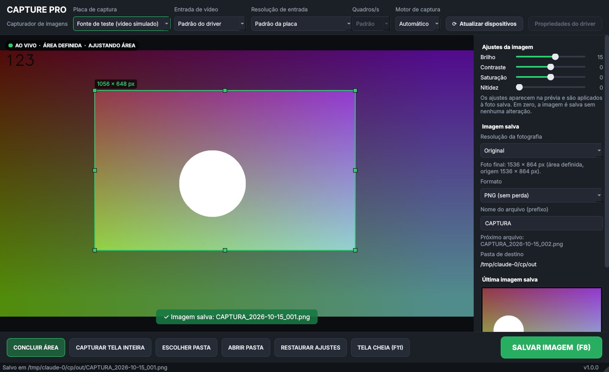

# Capture Pro 1.0



Capturador de imagens estáticas para placas de captura de vídeo no Windows 10 e 11
(ultrassonografia, endoscopia e outras fontes de vídeo). Funciona 100% offline: sem login, sem
internet, sem navegador.

## Instalação (computador do consultório)

1. Baixe os **dois** arquivos para a mesma pasta (por exemplo, *Downloads*):
   `CapturePro-Setup-1.0.0.exe` e `CapturePro-Setup-1.0.0-parte2.exe`.
   (O instalador foi dividido em duas partes por causa do limite de tamanho de download.)
2. Execute **`CapturePro-Setup-1.0.0.exe`** e avance as telas (pede permissão de
   administrador). A parte 2 é instalada automaticamente.
3. Abra pelo ícone **Capture Pro** da Área de Trabalho ou do Menu Iniciar.

Se o Windows mostrar "O Windows protegeu o computador" (SmartScreen), clique em
*Mais informações → Executar assim mesmo*: o instalador não tem assinatura digital paga.

Não é preciso instalar Python, .NET nem nenhuma outra ferramenta: tudo vem dentro
do instalador. Para remover: *Configurações → Aplicativos → Capture Pro → Desinstalar*.
As fotos e as configurações **não** são apagadas na desinstalação.

**Versão portátil:** o `build.sh` também gera `CapturePro-Portatil-1.0.0.zip`;
descompacte em qualquer pasta (ou pendrive) e abra `CapturePro.exe`.

Requisitos: Windows 10 (versão 1809 ou mais nova) ou Windows 11, 64 bits.
Placas PCI/PCIe e alguns modelos USB exigem o **driver do fabricante** instalado
antes; placas USB "UVC" funcionam com o driver do próprio Windows.

## Uso diário

1. Escolha a **placa de captura** no alto da janela (a última usada é lembrada).
2. Clique em **DEFINIR ÁREA**, arraste a moldura verde sobre a imagem do exame
   (cantos e bordas redimensionam; arrastar por dentro move) e clique em
   **CONCLUIR ÁREA**. A área fica gravada, inclusive depois de fechar o programa.
3. Clique em **SALVAR IMAGEM** ou aperte **F8**. Só o interior da moldura é salvo,
   na resolução real do vídeo, sem a moldura. O vídeo não é interrompido.

| Tecla | Função |
|---|---|
| **F8** | Salvar imagem |
| **F11** | Tela cheia (liga/desliga) |
| **ESC** | Sair da tela cheia / concluir área |

### Botões e controles

- **Placa de captura / Atualizar dispositivos** – lista as placas; detecta placas conectadas depois.
- **Entrada de vídeo** – escolhe HDMI/SDI, RCA (composto), S-Video, componente… quando o driver permite (crossbar DirectShow). Fica "Padrão do driver" quando a placa tem entrada única.
- **Resolução de entrada** – somente os modos anunciados pela placa. Prefira os marcados *sem compressão* (YUY2) para máxima fidelidade; *MJPG* é comprimido.
- **Quadros/s** – taxas aceitas pelo modo escolhido.
- **Motor de captura** – DirectShow (padrão, compatível com placas antigas) ou Media Foundation.
- **Propriedades do driver** – abre a janela de configuração do próprio fabricante.
- **CAPTURAR TELA INTEIRA** – remove o recorte (salva o quadro inteiro).
- **ESCOLHER PASTA / ABRIR PASTA** – pasta de destino (padrão: `Imagens\Capturas`).
- **RESTAURAR AJUSTES** – volta brilho, contraste, saturação e nitidez a zero.
- **Painel lateral** – ajustes (aparecem na prévia e na foto), resolução da foto
  (Original, 640×480 … 1920×1080, Personalizada), formato (PNG padrão, JPEG com
  qualidade, BMP), prefixo do nome, última imagem (clique para abrir), contador e
  "Iniciar com o Windows" (desligado por padrão).

Nomes dos arquivos: `CAPTURA_2026-10-15_001.png`, `…_002.png`… A numeração
continua a partir do maior número existente na pasta e um arquivo **nunca** é
sobrescrito.

### Fidelidade da imagem

- Com todos os ajustes em zero, a foto é gravada **bit a bit igual** ao quadro recebido da placa.
- Os ajustes são lineares e moderados; não há filtros automáticos.
- Resolução de saída maior que a real é avisada ("exige interpolação"); a proporção nunca é deformada.
- PNG e BMP são sem perda; JPEG usa a qualidade escolhida (padrão 95).

### Mensagens de estado

O selo no canto da prévia mostra **AO VIVO**, **SEM SINAL** (sem quadros ou imagem
totalmente preta — equipamento desligado/cabo solto/entrada errada), **CONECTANDO**
ou **DESCONECTADO**. Se a placa USB for removida e recolocada, o programa reconecta
sozinho.

## Solução de problemas

| Situação | O que fazer |
|---|---|
| Nenhuma placa na lista | Instale o driver do fabricante, reconecte a placa e clique em *Atualizar dispositivos*. |
| "Não foi possível abrir a placa" | Feche outros programas que usam a placa; troque o *Motor de captura*. |
| Sem sinal | Ligue o equipamento de vídeo; confira o cabo e a *Entrada de vídeo*. |
| Imagem com cores ou tamanho estranhos | Escolha outra *Resolução de entrada* (de preferência YUY2). |

Registro de eventos: `%APPDATA%\CapturePro\capturepro.log`.
Configurações: `%APPDATA%\CapturePro\config.json` (apagar este arquivo restaura tudo ao padrão).

## Download

Os instaladores estão na pasta [`instaladores/v1.0.0`](instaladores/v1.0.0): baixe os dois arquivos `.exe`.

Como esta versão foi construída, passo a passo: [docs/COMO-FOI-FEITO.md](docs/COMO-FOI-FEITO.md).
Especificação original: [docs/especificacao-original.txt](docs/especificacao-original.txt).

## Tecnologia

O pedido original preferia C#/.NET 8/WPF. O ambiente onde o programa foi
construído não tinha acesso aos servidores da Microsoft (SDK .NET e NuGet), então
foi feito com tecnologias equivalentes, todas offline e embutidas:

- **Python 3.12** embutido + lançador nativo `CapturePro.exe` (C, ícone próprio, sem console).
- **Qt 6 / PySide6** – interface (Widgets), tema escuro.
- **OpenCV 4.14** – captura via **DirectShow** e **Media Foundation**, e processamento de imagem.
- **comtypes + pygrabber** – consulta direta ao DirectShow: nomes das placas,
  modos reais (`IAMStreamConfig`, VIDEOINFOHEADER e VIDEOINFOHEADER2) e entradas
  físicas (`IAMCrossbar`).
- Instalador **NSIS** em português.

### Estrutura

```
src/main.py                      entrada (usada pelo CapturePro.exe)
src/capturepro/app.py            inicialização, log, instância única
src/capturepro/devices.py        descoberta de dispositivos e modos
src/capturepro/dshow.py          DirectShow: modos, crossbar (Windows)
src/capturepro/capture.py        thread de captura, prévia, sem sinal, reconexão
src/capturepro/processing.py     ajustes, recorte, redimensionamento
src/capturepro/storage.py        gravação PNG/JPEG/BMP sequencial e segura
src/capturepro/settings.py       configurações globais e por dispositivo
src/capturepro/autostart.py      iniciar com o Windows
src/capturepro/ui/               janela principal, prévia com moldura, tema
tests/                           testes automatizados (pytest)
build/                           lançador C, montagem, instalador NSIS, build.sh
CapturePro.sln / .pyproj         abre no Visual Studio (carga de trabalho Python)
```

### Rodar a partir do código

```
pip install -r requirements.txt
python src/main.py
python -m pytest tests          # testes
```

### Gerar executável e instalador

Em Linux (Ubuntu 24.04) com `nsis`, `gcc-mingw-w64-x86-64` e Python 3.12:
`./build/build.sh` → `dist/CapturePro/`, `dist/CapturePro-Setup-<versão>.exe` +
`dist/CapturePro-Setup-<versão>-parte2.exe`, `dist/CapturePro-Portatil-<versão>.zip`.

## Testes realizados

**Automatizados (35 testes, todos aprovados)** – rodados com uma fonte de vídeo
simulada, nas mesmas versões de bibliotecas da versão Windows:
recorte em coordenadas reais; recorte independente do tamanho da janela; moldura
desenhada, movida e redimensionada com o mouse; foto contém só a área e nenhuma
moldura; PNG/BMP sem perda, JPEG com qualidade; ajustes aplicados e restaurados;
ajustes neutros bit a bit; resolução de saída sem deformar e aviso de
interpolação; numeração sequencial sem sobrescrever (inclusive pastas com
acentos); escolher/abrir pasta; F8, F11 e ESC; tela cheia; troca de resolução,
taxa de quadros e entrada; atualizar dispositivos; detecção de "sem sinal" e
imagem preta; reconexão automática após perda do sinal; persistência das
configurações ao reabrir; recuperação de configuração corrompida; mensagem sem
dispositivos; leitura dos formatos DirectShow (VIDEOINFOHEADER/2, FOURCC).

**Windows (verificado com Wine 9 em Linux):** instalador em duas partes
(instalação, arquivos idênticos à distribuição, atalhos, entrada em "Aplicativos",
aviso quando falta a parte 2, desinstalação); lançador `CapturePro.exe` iniciando
o Python embutido isolado; opção "Iniciar com o Windows" (registro);
tratamento de falha do DirectShow sem derrubar o programa. Todas as DLLs
necessárias foram conferidas pelos cabeçalhos PE.

**Teste de campo em Windows real (realizado e informado pelo autor, Dr. Celso Matos
Junior, em 15/10/2026):** testado com placa de captura **USB 3.0 com entrada HDMI**
para captura de **ultrassonografia em equipamento de última geração V7** —
**100% funcional**.

**Ainda não testado:** outros tipos de placa (USB 2.0, PCI/PCIe, DirectShow antigas),
entradas RCA/S-Video, troca de entrada pelo crossbar e Media Foundation.
