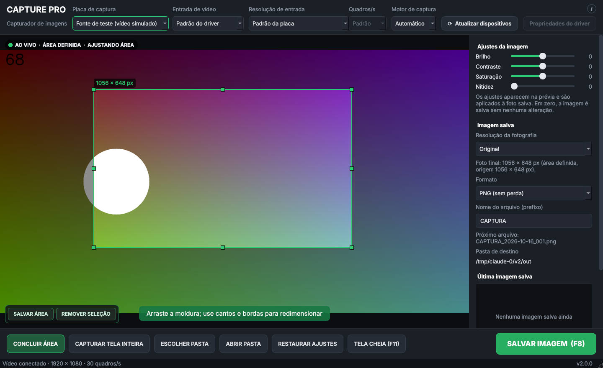
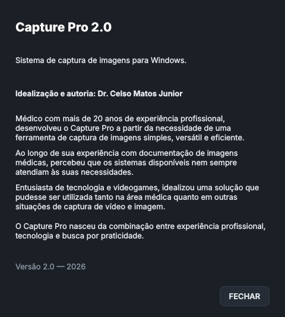

# Capture Pro 2.0 — registro da atualização

Atualização **incremental e conservadora** da 1.0 (16/10/2026), feita conforme
[`especificacao-v2.0.txt`](especificacao-v2.0.txt). Nada além das três alterações abaixo foi
modificado: captura, prévia, moldura, recorte, ajustes, formatos, salvamento, atalhos,
reconexão, persistência e aparência continuam exatamente como na 1.0.

## Preservação da 1.0

- Branch **`versao-1.0.0`** aponta para o último commit da 1.0 (`b0c8e56`): código,
  testes, documentos e instaladores originais.
- Pasta `instaladores/v1.0.0` mantida sem alteração (os dois `.exe` continuam disponíveis).
- Desenvolvimento feito na branch `feature/v2.0.0` e integrado à `main` só depois de testado.
- `docs/COMO-FOI-FEITO.md` (história da 1.0) mantido.

## As três alterações

### 1. SALVAR ÁREA e REMOVER SELEÇÃO

- O botão **DEFINIR ÁREA** não foi alterado (tamanho, posição, cor, ação, texto
  "CONCLUIR ÁREA" durante a edição). Moldura, alças, cores, algoritmo e cálculo do recorte:
  sem nenhuma alteração (`video_view.py` não foi tocado).
- Ao entrar no modo de área aparece um pequeno painel flutuante no canto inferior esquerdo
  da prévia, logo acima de DEFINIR ÁREA, com **SALVAR ÁREA** e **REMOVER SELEÇÃO**.
  Ele fica fora dos layouts, portanto não desloca nenhum botão (verificado por teste) e não
  altera a área de visualização. Some ao concluir, salvar, remover ou apertar ESC.
  *Por que flutuante:* colocado na barra inferior, ele apertava os outros botões em janelas
  menores; flutuando, nenhum botão se move.
- **SALVAR ÁREA** chama a ação existente de CONCLUIR ÁREA e grava na hora pelo mecanismo de
  persistência existente (`_persist_now`).
- **REMOVER SELEÇÃO** chama a ação existente de CAPTURAR TELA INTEIRA (`full_image`) e grava
  na hora, para que a área antiga não volte ao reiniciar.
- CONCLUIR ÁREA e CAPTURAR TELA INTEIRA continuam funcionando como antes.

### 2. Ícone "i" — Sobre o Capture Pro

- Botão redondo de 22 × 22 px com um "i", na célula vazia acima de *Propriedades do driver*
  (canto superior direito). Não desloca nenhum elemento (comparação pixel a pixel com a 1.0).
- Abre a janela modal *Sobre o Capture Pro* com o texto pedido e apenas o botão **FECHAR**.

### 3. Instalador único

- `build/installer.nsi` passou a embutir todos os arquivos (inclusive o OpenCV); a chamada da
  parte 2 e a verificação do segundo arquivo foram retiradas. `build.sh` não gera mais a parte 2.
  `installer_part2.nsi` foi mantido apenas como histórico da 1.0.
- Resultado: **`CapturePro-Setup-2.0.0.exe` (43 MB)**, nenhum download adicional.
- Atualização sobre a 1.0: fecha o programa, substitui os arquivos do programa e **não toca**
  em `%APPDATA%\CapturePro` nem nas imagens. Antes de tudo, cria
  `config.backup-antes-v2.0.0.json`. O formato da configuração é o mesmo da 1.0, então não
  há migração.
- Publicação: a criação de GitHub Releases e o envio de tags não são permitidos a partir do
  ambiente onde o programa é construído, por isso o instalador está em
  `instaladores/v2.0.0` (o GitHub aceita arquivos de até 100 MB). Você pode criar a Release
  `v2.0.0` e anexar o mesmo arquivo pela página do repositório.
- O pacote 2.0 é idêntico ao da 1.0 (Python, Qt, OpenCV, NumPy, DLLs), exceto pelos arquivos
  do aplicativo listados abaixo, pelo lançador recompilado e pelo bytecode pré-compilado
  (`.pyc`), que agora vai junto e deixa a abertura do programa mais rápida.

## Arquivos alterados

| Arquivo | Alteração |
|---|---|
| `src/capturepro/__init__.py` | versão `2.0.0` |
| `src/capturepro/ui/main_window.py` | painel SALVAR ÁREA / REMOVER SELEÇÃO, ícone Sobre e suas ações |
| `src/capturepro/ui/about_dialog.py` | **novo** — janela Sobre |
| `src/capturepro/ui/theme.py` | estilos dos novos elementos (regras novas; nenhuma existente mudou) |
| `build/installer.nsi` | instalador único + cópia de segurança da configuração |
| `build/build.sh` | não gera mais a parte 2 |
| `build/installer_part2.nsi` | apenas um comentário: "histórico da 1.0" |
| `tests/test_v2.py` | **novo** — 11 testes da 2.0 |
| `README.md`, `docs/VERSAO-2.0.md`, `docs/especificacao-v2.0.txt`, imagens em `docs/` | documentação |
| `instaladores/v2.0.0/` | **novo** — instalador, SHA256SUMS, LEIA-ME |

Não alterados: `capture.py`, `processing.py`, `storage.py`, `settings.py`, `devices.py`,
`dshow.py`, `autostart.py`, `app.py`, `video_view.py`, `tests/test_core.py`, `tests/test_ui.py`.

## Resultados dos testes

| # | Verificação | Resultado |
|---|---|---|
| 1–2 | 35 testes da 1.0, sem alteração | ✅ todos aprovados |
| 3 | SALVAR ÁREA grava e recorta só o interior | ✅ |
| 4 | REMOVER SELEÇÃO apaga a área | ✅ |
| 5 | Opções ocultas fora do modo de área (inclusive após ESC) | ✅ |
| 6 | Moldura igual à 1.0; botões não se deslocam | ✅ (testes da 1.0 + comparação pixel a pixel) |
| 7 | Área salva sobrevive ao reiniciar | ✅ |
| 8 | Remover volta à imagem inteira (1920 × 1080) | ✅ |
| 9 | Remoção sobrevive ao reiniciar | ✅ |
| 10 | Janela Sobre abre, mostra o texto e fecha | ✅ |
| 11 | Instalação com um único executável numa pasta vazia | ✅ (Wine 9) |
| 12 | Arquivos da 1.0 preservados (branch + `instaladores/v1.0.0`) | ✅ |
| 13 | Atualização 1.0 → 2.0 não apaga imagens nem configurações | ✅ (SHA-256 antes/depois, Wine 9) |
| — | Configuração no formato 1.0 lida sem perdas pela 2.0 | ✅ |
| — | Desinstalação preserva imagens e configurações | ✅ (Wine 9) |

Total automatizado: **46 testes, todos aprovados**.

**Limitação declarada:** o instalador foi validado no Wine 9 (simulação do Windows em
Linux), não num Windows físico. A interface do programa não roda no Wine (faltam
componentes que o Qt usa), então a janela foi conferida pelos testes e capturas de tela no
Linux, com as mesmas versões das bibliotecas. **Falta a validação final no computador do
consultório:** instalar a 2.0 por cima da 1.0 e conferir as duas opções de área e o ícone Sobre
com a placa USB 3.0 HDMI.

